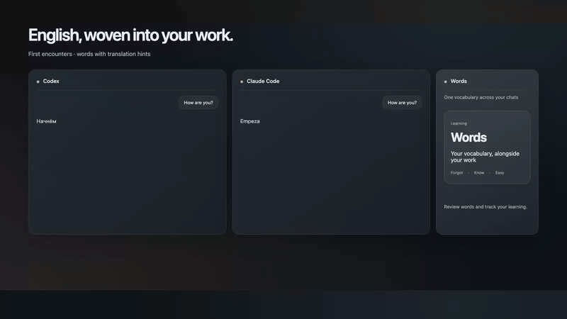

# Words by LaboratorU

Learn English while you work with Claude Code and Codex.

Words is a free macOS menu bar companion: meet English words in your normal chat
replies, revisit them in rotating cards, hear pronunciation and track shared local
progress across connected chat apps.

**Public preview · Apple Silicon · macOS 15 or later**

[Download Words 0.2.0 (14)](https://github.com/Artimed/words-by-laboratoru/releases/download/v0.2.0-14/Words-0.2.0-14.dmg)

The application and installer are Developer ID signed and Apple-notarized.
This preview is being tested on additional Macs; Intel Macs are not supported.

## See Words in action

[Watch or download the 30-second demo](https://github.com/Artimed/words-by-laboratoru/releases/download/v0.2.0-12/Words-demo.mp4).
This is an animated illustration, not a screen recording. Learning time is compressed;
languages alternate to showcase translations, not automatic language switching.
The first release focuses on individual words; later sentence stages require learner
choice and are not promised as automatic progression. Highlights are editorial cues,
not proof of mastery.

## Install

1. Download and open the DMG.
2. Drag Words to Applications, then open it from Applications.
3. Choose your translation language and optionally connect Claude Code and/or Codex.
4. Start a new chat session; quit and reopen Codex if needed. In Codex, look at the
   **bottom of the message composer** for a **small hooks icon with a yellow dot**.
   Click it to open the pending hook review. If a **Review hooks** notice is already
   visible, use that instead. Expand both entries and verify that their commands run
   Words `prompt_hook.py` and `stop_hook.py`, then allow those two hooks. Learning
   words will not appear in Codex replies until approval. Labels follow your Codex
   language; the pending icon can be easy to miss. Claude Code did not show this
   extra approval in our tested setup; follow any prompts in your own version.
5. Eject Words Installer. Words lives in the menu bar, without a Dock icon.

Updating: quit Words and replace the app in Applications. Do not uninstall if you
want to retain your progress. Full removal is available in Settings → About.

## Updates

Starting with build 12, Words includes Sparkle app updates. Automatic checks are on
by default and can be disabled in Settings → About. When an update is found, an
update button appears in Words and the menu-bar ticker says “Update available”.
Choose the update and confirm installation; learning data stays in its separate folder.
Use **Check for Updates…** in About to check manually. The circular arrow in the
panel only reloads local learning data.

Users on build 11 need one manual update from the DMG to obtain this mechanism.

## Included

- 410 English words; fresh setup starts with 10 Learning and 400 New.
- Russian, Spanish, Simplified Chinese, Brazilian Portuguese, Japanese, German,
  Indonesian and French translations, downloaded separately without GitHub sign-in.
- English pronunciation, speech, search, cards, light/dark appearance and color palettes.
- Detachable movable window, remembered position and return to menu-bar mode.
- Optional local adapters for Claude Code and Codex; either can be used independently.

Repeated encounters are exposure, not proof of mastery. This preview focuses on
individual words. Later sentence-learning stages are not automatic.

## Privacy, source and feedback

Learning data is stored locally. Connected model providers process their normal chat
context; GitHub serves dictionary downloads. See [Privacy](PRIVACY.md).

This repository distributes the application and information, **not its source code**.
Original source remains proprietary; no open-source license is granted. Third-party
licenses remain applicable: see [Notices](THIRD_PARTY_NOTICES.md).

For ordinary preview bugs, open an issue with your macOS and Words versions and
steps to reproduce. Never post credentials, chat transcripts or personal progress.
For sensitive security reports, see [Security](SECURITY.md).

Made by [LaboratorU](https://laboratoru.com/en/?utm_source=words).
Not affiliated with Apple, OpenAI or Anthropic.
